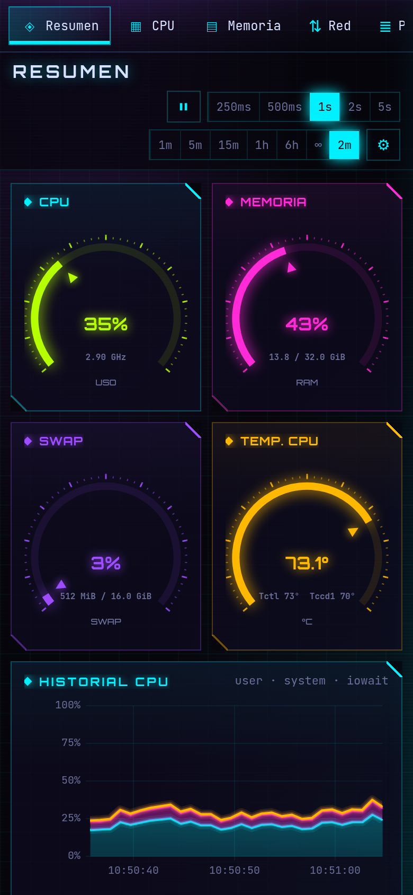

<p align="center">
  
</p>

<h1 align="center">NeonTop</h1>

<p align="center">
  Monitor de recursos para Linux al estilo <b>btop</b>, con interfaz gráfica de escritorio, estética neón/cyberpunk<br>
  y medición de FPS de juegos integrada.
</p>

<p align="center">
  
  
  
  
  
</p>


## Índice

- [Características](#características)
- [Capturas](#capturas)
- [Medición de FPS en juegos](#medición-de-fps-en-juegos)
- [Instalación](#instalación)
- [Compilar desde el código](#compilar-desde-el-código)
- [Desarrollo](#desarrollo)
- [Arquitectura](#arquitectura)
- [Permisos y privacidad](#permisos-y-privacidad)
- [Licencia](#licencia)

## Características

| Pestaña | Qué muestra |
|---|---|
| **Resumen** | CPU, RAM, swap y temperatura en velocímetros; historial de CPU, memoria y red; presión (PSI), carga media y datos del sistema. |
| **CPU** | Reparto user/system/iowait/irq…, mapa de calor por núcleo, frecuencia por núcleo, uso radial, temperatura, cambios de contexto, interrupciones y forks. |
| **Memoria** | Apps, caché, buffers, shmem, y swap; test de ancho de banda y latencia de RAM; **tráfico de RAM en vivo** con los contadores uncore del procesador (AMD Zen e Intel). |
| **Red** | Bajada/subida por interfaz, totales, conexiones TCP/UDP. |
| **Procesos** | Árbol y lista ordenable, CPU/RAM/E-S/GPU por proceso, búsqueda, señales y prioridad (con elevación opcional mediante polkit). |
| **Discos** | Uso por punto de montaje, lectura/escritura, IOPS y ocupación de cada dispositivo. |
| **Sensores** | Todo lo que exponga hwmon: temperaturas, ventiladores, voltajes y potencias. |
| **GPU** | AMD (sysfs + `gpu_metrics`), NVIDIA (NVML) e Intel (i915/xe): uso por motor, VRAM, relojes, potencia, temperatura y uso por proceso (fdinfo). |
| **Energía** | Consumo del equipo por componente: RAPL de CPU, GPU, fuentes de alimentación compatibles y **SAI APC** vía `apcupsd`; histórico diario y coste. |
| **Juegos** | FPS, 1 % y 0,1 % bajo, tiempos de fotograma, tirones, estabilidad, qué limita los FPS (CPU/GPU/tope) y grabación de benchmarks con historial por juego. |

Además:

- **25 temas** (más uno que sigue al tema del sistema) en 5 categorías (clásicos, neón, terminal, editores, temáticos), cada uno con su paleta, tipografía, esquinas y efectos (brillo, CRT).
- **Muestreo configurable** de 100 ms a 60 s y ventana de historial de 1 minuto a **ilimitada**.
- **Acceso web**: abre NeonTop desde el teléfono u otro equipo de la red (código QR, clave de acceso, acciones opcionales).
- **Alertas** configurables (disco casi lleno, temperatura, SAI en batería…) con notificaciones del sistema.
- **Bandeja del sistema**, arranque con la sesión, instancia única y exportación a CSV.
- Interfaz **responsiva**: funciona igual en una pantalla de 2560 px que en un móvil.
- Todo en **español**.

## Capturas

| | |
|---|---|
|  **CPU** |  **Memoria** |
|  **Red** |  **Procesos** |
|  **Discos** |  **Sensores** |
|  **GPU** |  **Energía** |
|  **Juegos** |  **Tema Synthwave** |
|  **Tema Catppuccin Latte** |  **Tema Matrix** |

<p align="center">
  <br>
  <em>Acceso web desde el teléfono</em>
</p>

> Las capturas están hechas con el modo demostración (datos simulados), ver [Desarrollo](#desarrollo).

## Medición de FPS en juegos

NeonTop trae su propia capa de medición (parecida a MangoHud, en C, sin dependencias):

- **Vulkan**: capa implícita (`libneontop_layer.so`) que solo se activa con `NEONTOP_FPS=1`. Cubre los juegos Vulkan nativos y todo **Proton/Wine** (DirectX vía DXVK y VKD3D).
- **OpenGL** (GLX y EGL): librería precargada (`libneontop_gl.so`) que intercepta el intercambio de búferes. Convive con el overlay de Steam y con MangoHud.
- 64 y 32 bits. Cada fotograma se anota en memoria compartida (`/dev/shm/neontop-fps-<pid>`) y NeonTop lo lee sin tocar el juego.

### Activación automática

En la pestaña **Juegos → Medición automática**, NeonTop añade el lanzador `neontop-fps` por ti:

| Lanzador | Qué se modifica |
|---|---|
| **Steam** | Opciones de lanzamiento de cada juego instalado (`neontop-fps %command%`), respetando las que ya hubiera. |
| **Heroic** | Envoltorio de cada juego y de los juegos nuevos. |
| **Lutris** | Prefijo de comando global. |
| **Prism Launcher** | Envoltorio global (Minecraft). |

Los cambios se aplican **solo con el lanzador cerrado** (Steam reescribe su configuración al salir) y antes se guarda una copia `<fichero>.neontop-bak`. Al desactivar la opción, NeonTop quita lo que añadió.

### A mano

```sh
# Steam → Propiedades → Opciones de lanzamiento
neontop-fps %command%
# combinable con otros lanzadores
neontop-fps gamemoderun mangohud %command%
# cualquier programa
neontop-fps ./juego
```

## Instalación

### Arch Linux / CachyOS / Manjaro

El `PKGBUILD` de [`packaging/arch`](packaging/arch) compila dos paquetes (se excluyen entre sí, instala uno):

| Paquete | Para |
|---|---|
| `neontop` | Cualquier PC x86-64 (genérico). |
| `neontop-native` | Optimizado para la CPU donde se compila (`-march=native`). En otra CPU puede fallar con SIGILL. |

```sh
git clone https://github.com/beiacox/neontop.git
cd neontop/packaging/arch
makepkg -f
sudo pacman -U neontop-<versión>-x86_64.pkg.tar.zst
```

Dependencias opcionales: `apcupsd` (SAI APC), `nvidia-utils` (GPU NVIDIA), `lm_sensors` (sensores de placa base) y `vulkan-icd-loader` (FPS en juegos Vulkan/Proton).

### Otras distribuciones

`npm run bundle` genera paquetes `.deb`, `.rpm` y AppImage con Tauri (la capa de FPS y el lector de tráfico de RAM se instalan aparte, ver el `PKGBUILD`).

## Compilar desde el código

Requisitos: Rust estable, Node.js 20+ y las dependencias de Tauri 2 para Linux (`webkit2gtk-4.1`, `gtk3`, `libayatana-appindicator`). Para la capa de FPS: `gcc`, `vulkan-headers` y `lib32-glibc` (32 bits).

```sh
npm ci
npm run tauri dev                         # app de escritorio en modo desarrollo
npm run tauri build -- --no-bundle        # binario de release en src-tauri/target/release/neontop
make -C packaging/layer                   # capa de FPS (64 y 32 bits)
```

## Desarrollo

- **Modo demostración**: `npm run dev` y abre `http://localhost:1420` en el navegador. Sin backend, [`src/lib/demo.ts`](src/lib/demo.ts) simula todos los datos (incluido un juego). Parámetros útiles: `?tab=games&theme=synthwave`.
- **Comprobación de tipos**: `npm run check`.
- **Tests del backend**: `cd src-tauri && cargo test`.
- **Probar la capa de FPS sin instalar**: `VK_ADD_IMPLICIT_LAYER_PATH=<dir con el json> NEONTOP_FPS=1 vkcube`.

## Arquitectura

```
src/                     Interfaz (SvelteKit + Svelte 5, uPlot y ECharts)
  lib/modules/           Una vista por pestaña
  lib/charts/            Gráficas (series temporales, velocímetros, mapas de calor…)
  lib/theme.ts           Temas
src-tauri/src/           Backend (Rust)
  collectors/            Lectura directa de /proc y /sys: cpu, memoria, red, discos, hwmon,
                         GPU (AMD/NVIDIA/Intel), energía, SAI, juegos, tráfico de RAM…
  sampler.rs             Bucle de muestreo; emite un evento "metrics" por muestra
  web.rs                 Servidor web (acceso desde el teléfono)
  helper.rs              Acciones de administrador vía pkexec
  launchers.rs           Medición de FPS automática en Steam/Heroic/Lutris/Prism
  sessions.rs            Historial de partidas en disco
packaging/
  arch/                  PKGBUILD
  layer/                 Capa de FPS (C): Vulkan + precarga OpenGL + lanzador neontop-fps
  membw/                 Lector de contadores de tráfico de RAM (recibe CAP_PERFMON)
```

El backend no usa `sysinfo`: lee `/proc` y `/sys` directamente, y las recogidas caras (procesos, GPU por proceso) solo se hacen con la vista que las necesita abierta. En release consume alrededor de un 5 % de un núcleo con muestreo de 1 s.

## Permisos y privacidad

- NeonTop funciona como usuario normal. Lo que necesita root (contadores RAPL, señales a procesos de otros usuarios, tráfico de RAM) se pide **solo cuando lo activas**, con `pkexec` y la política [`com.neontop.app.policy`](packaging/com.neontop.app.policy).
- El servidor web está **desactivado por defecto**; al activarlo usa una clave aleatoria y las acciones (pausar, señales) son opcionales.
- No envía nada a Internet. La configuración vive en `~/.config/com.neontop.app/` y el historial de partidas en `~/.local/share/com.neontop.app/`.

## Licencia

[MIT](LICENSE)
