<p align="center">
  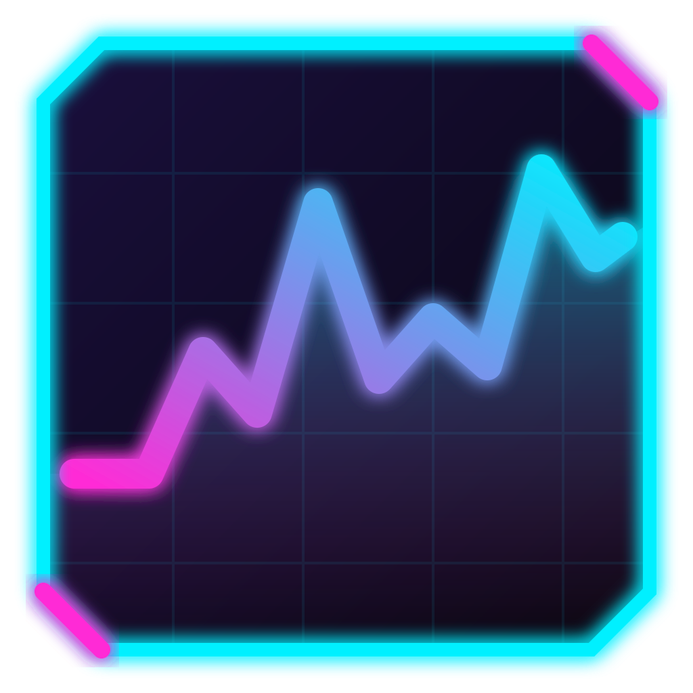
</p>

<h1 align="center">NeonTop</h1>

<p align="center">
  Monitor de recursos para Linux al estilo <b>btop</b>, con interfaz gráfica de escritorio, estética neón/cyberpunk<br>
  y medición de FPS de juegos integrada.
</p>

<p align="center">
  
  
  
  
</p>

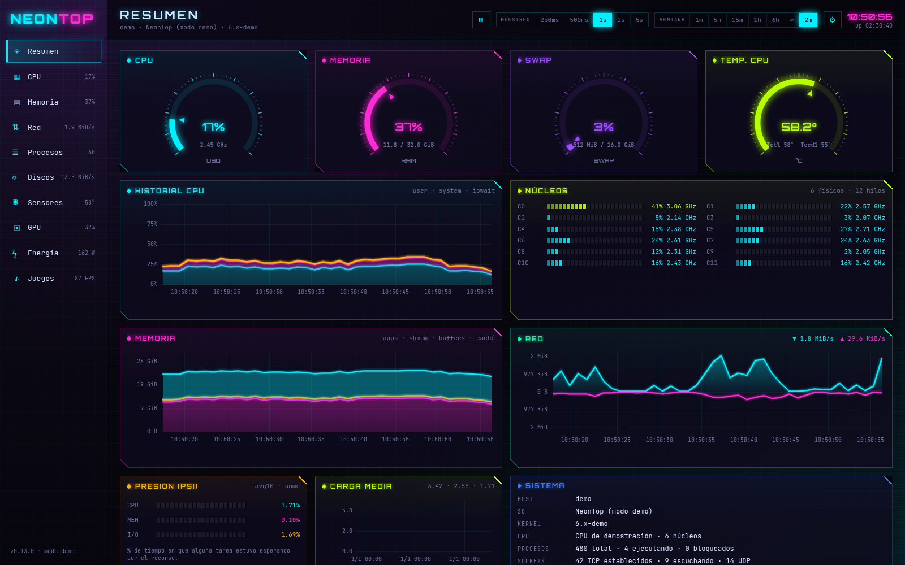

## Índice

- [Características](#características)
- [Capturas](#capturas)
- [Medición de FPS en juegos](#medición-de-fps-en-juegos)
- [Instalación](#instalación)
- [Compilar desde el código](#compilar-desde-el-código)
- [Desarrollo](#desarrollo)
- [Arquitectura](#arquitectura)
- [Permisos y privacidad](#permisos-y-privacidad)
- [Licencia](#licencia)

## Características

| Pestaña | Qué muestra |
|---|---|
| **Resumen** | CPU, RAM, swap y temperatura en velocímetros; historial de CPU, memoria y red; presión (PSI), carga media y datos del sistema. |
| **CPU** | Reparto user/system/iowait/irq…, mapa de calor por núcleo, frecuencia por núcleo, uso radial, temperatura, cambios de contexto, interrupciones y forks. |
| **Memoria** | Apps, caché, buffers, shmem, y swap; test de ancho de banda y latencia de RAM; **tráfico de RAM en vivo** con los contadores uncore del procesador (AMD Zen e Intel). |
| **Red** | Bajada/subida por interfaz, totales, conexiones TCP/UDP. |
| **Procesos** | Árbol y lista ordenable, CPU/RAM/E-S/GPU por proceso, búsqueda, señales y prioridad (con elevación opcional mediante polkit). |
| **Discos** | Uso por punto de montaje, lectura/escritura, IOPS y ocupación de cada dispositivo. |
| **Sensores** | Todo lo que exponga hwmon: temperaturas, ventiladores, voltajes y potencias. |
| **GPU** | AMD (sysfs + `gpu_metrics`), NVIDIA (NVML) e Intel (i915/xe): uso por motor, VRAM, relojes, potencia, temperatura y uso por proceso (fdinfo). |
| **Energía** | Consumo del equipo por componente: RAPL de CPU, GPU, fuentes de alimentación compatibles y **SAI APC** vía `apcupsd`; histórico diario y coste. |
| **Juegos** | FPS, 1 % y 0,1 % bajo, tiempos de fotograma, tirones, estabilidad, qué limita los FPS (CPU/GPU/tope) y grabación de benchmarks con historial por juego. |

Además:

- **24 temas** (más uno que sigue al modo claro/oscuro del escritorio) en 5 categorías (clásicos, neón, terminal, editores, temáticos), cada uno con su paleta, tipografía, esquinas y efectos (brillo, CRT).
- **Muestreo configurable** de 100 ms a 60 s y ventana de historial de 1 minuto a **ilimitada**.
- **Acceso web**: abre NeonTop desde el teléfono u otro equipo de la red (código QR, clave de acceso, acciones opcionales). Las páginas y sus gráficas SVG se generan en Rust en el propio equipo: el navegador no ejecuta JavaScript.
- **Alertas** configurables (disco casi lleno, temperatura, SAI en batería…) con notificaciones del sistema.
- **Bandeja del sistema** (cerrar la ventana la deja midiendo en la bandeja; el icono la vuelve a abrir), arranque con la sesión, instancia única y exportación a CSV.
- Interfaz **nativa en la GPU** con [GPUI](https://gpui.rs) (el motor de Zed): ~40 MiB y un proceso, frente a los cientos de MiB y los procesos de WebKit de la versión anterior. Se adapta al ancho de la ventana (4, 2 o 1 columnas).
- **Multilingüe**: español, inglés, portugués, francés y alemán. Por defecto sigue el idioma del sistema; se cambia en Ajustes → Idioma (o `--lang en` para una ejecución).

## Capturas

| | |
|---|---|
| 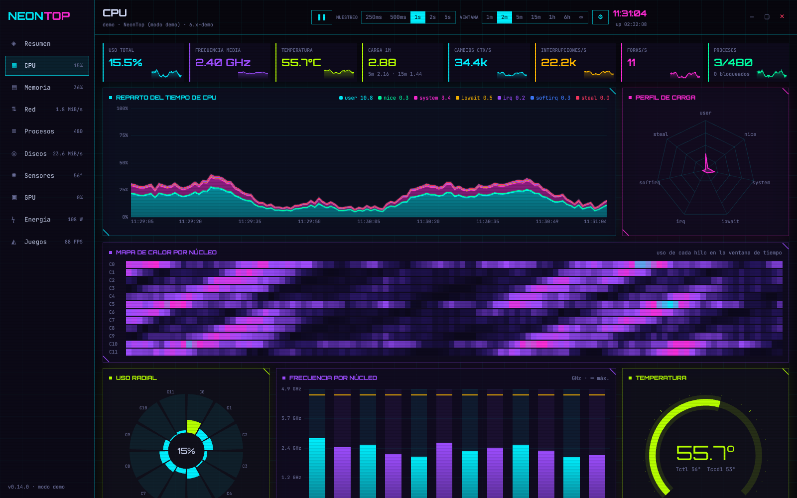 **CPU** | 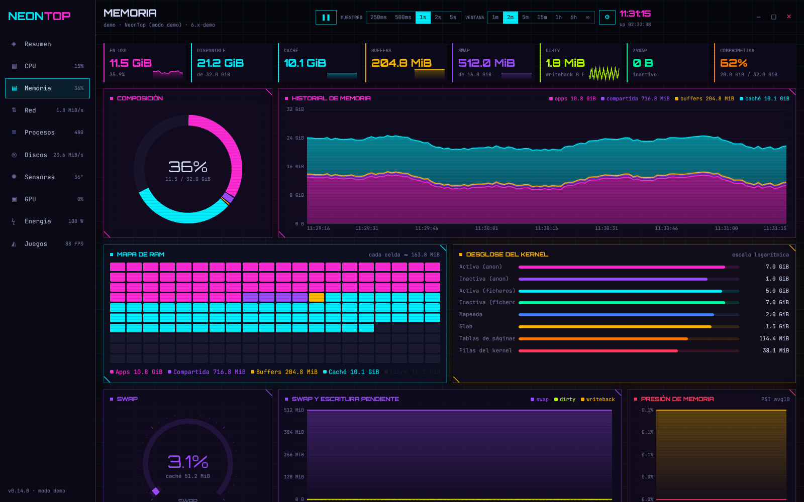 **Memoria** |
| 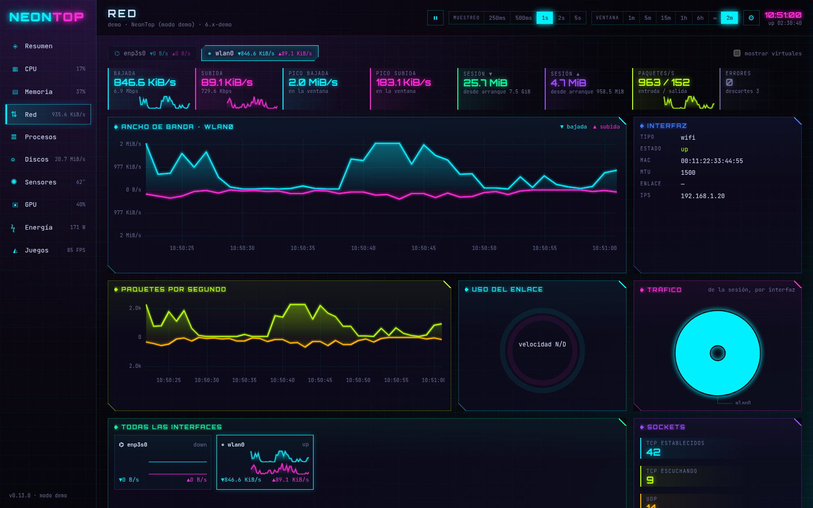 **Red** | 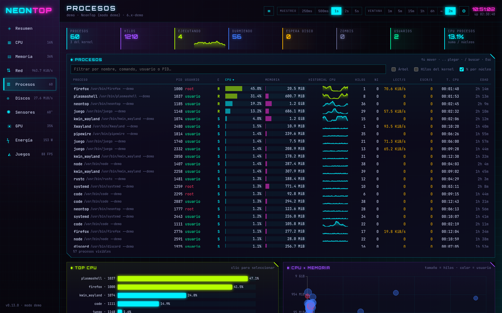 **Procesos** |
| 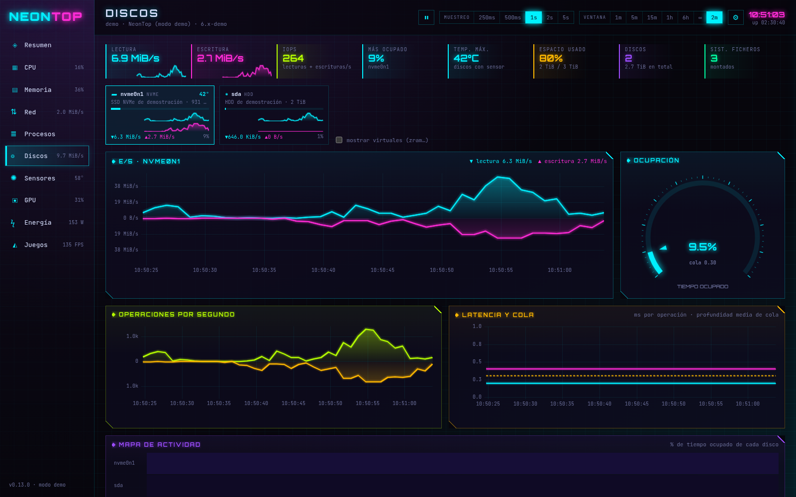 **Discos** | 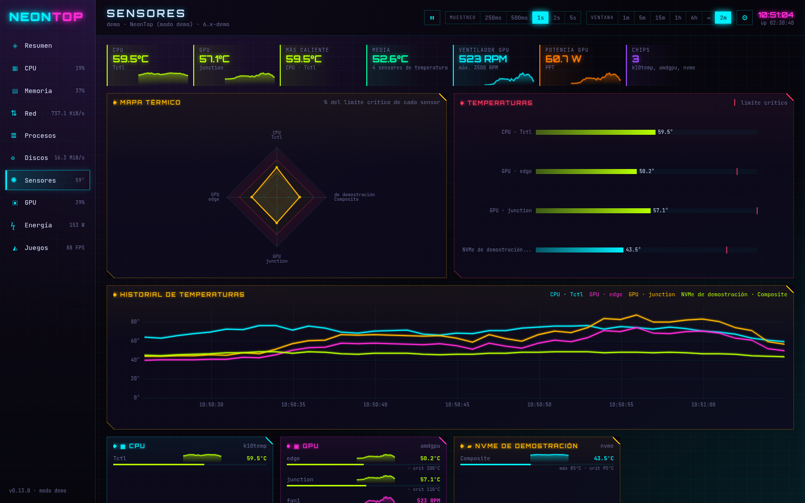 **Sensores** |
| 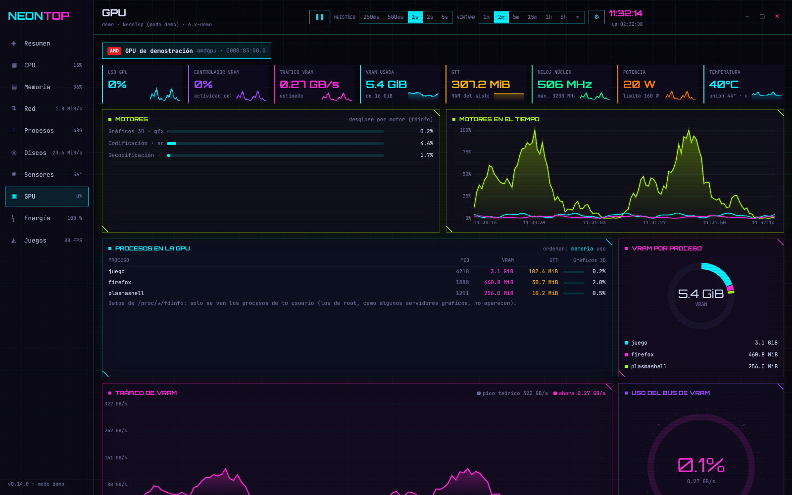 **GPU** | 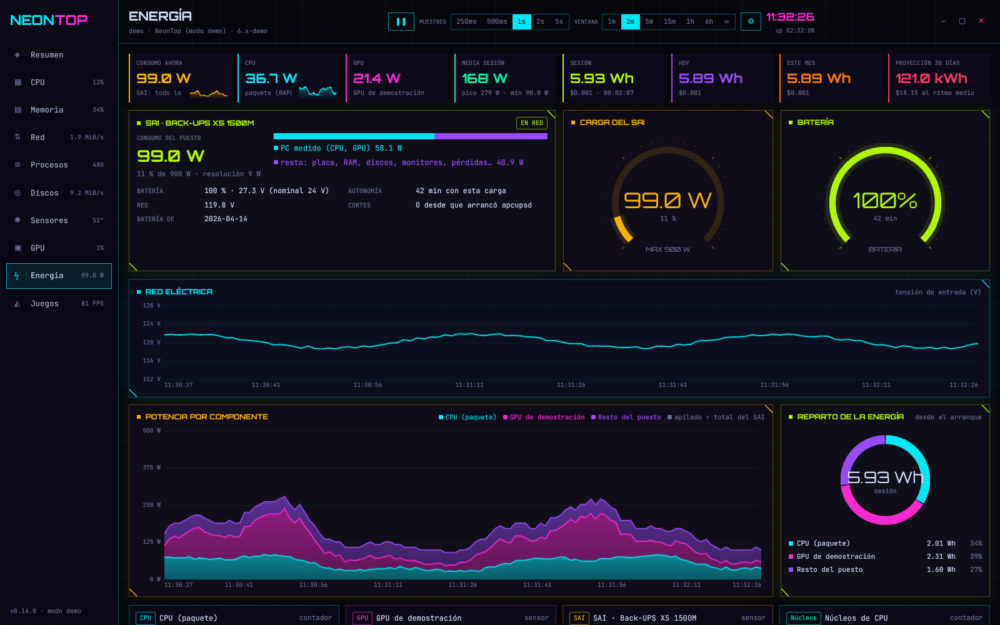 **Energía** |
| 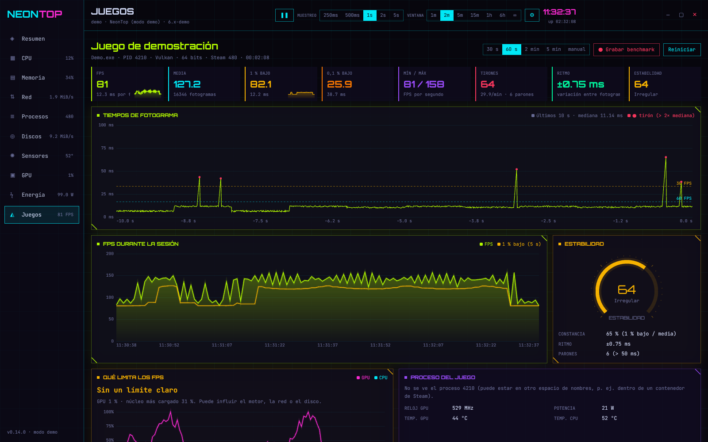 **Juegos** | 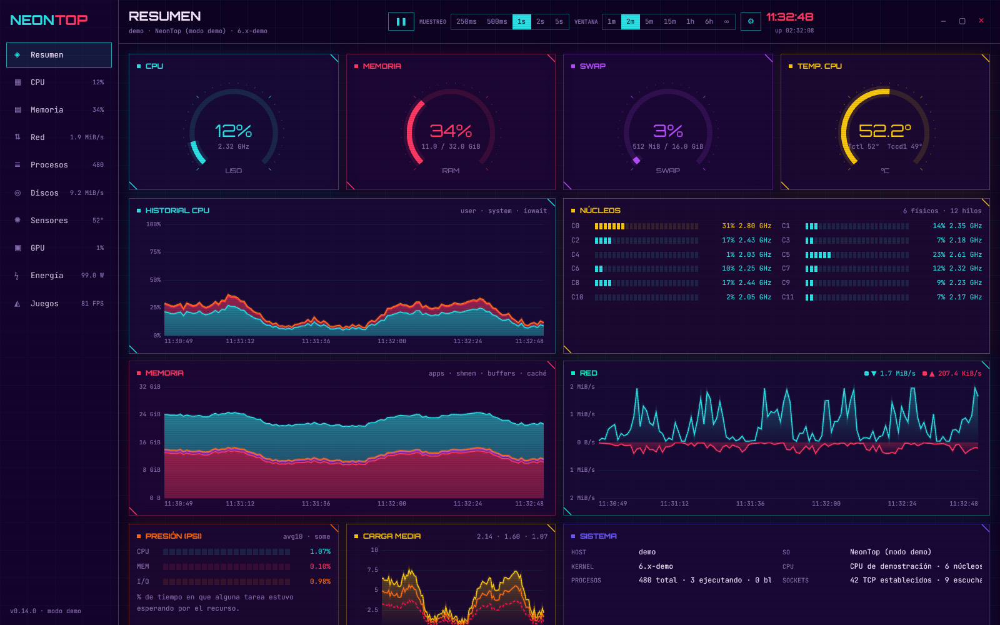 **Tema Synthwave** |
| 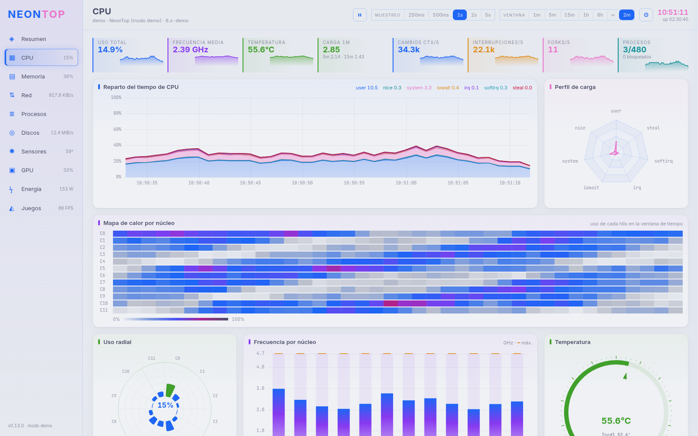 **Tema Catppuccin Latte** | 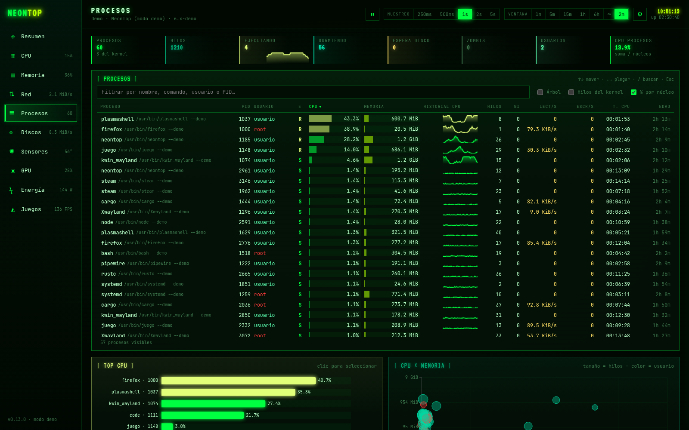 **Tema Matrix** |

> Las capturas están hechas con el modo demostración (`neontop --demo`, datos simulados), ver [Desarrollo](#desarrollo).

## Medición de FPS en juegos

NeonTop trae su propia capa de medición (parecida a MangoHud), escrita en Rust `no_std`: sin asignador ni inicialización, para no alterar el juego en el que se carga:

- **Vulkan**: capa implícita (`libneontop_layer.so`) que solo se activa con `NEONTOP_FPS=1`. Cubre los juegos Vulkan nativos y todo **Proton/Wine** (DirectX vía DXVK y VKD3D).
- **OpenGL** (GLX y EGL): librería precargada (`libneontop_gl.so`) que intercepta el intercambio de búferes. Convive con el overlay de Steam y con MangoHud.
- 64 y 32 bits. Cada fotograma se anota en memoria compartida (`/dev/shm/neontop-fps-<pid>`) y NeonTop lo lee sin tocar el juego. Con OpenGL sobre Vulkan (Zink) las dos librerías comparten estado y cada fotograma cuenta una sola vez.
- El lanzador `neontop-fps` (también en Rust) activa la capa y, solo con OpenGL nativo, la precarga; con Proton/Wine no precarga nada en la cadena de procesos de Steam.

### Activación automática

En la pestaña **Juegos → Medición automática**, NeonTop añade el lanzador `neontop-fps` por ti:

| Lanzador | Qué se modifica |
|---|---|
| **Steam** | Opciones de lanzamiento de cada juego instalado (`neontop-fps %command%`), respetando las que ya hubiera. |
| **Heroic** | Envoltorio de cada juego y de los juegos nuevos. |
| **Lutris** | Prefijo de comando global. |
| **Prism Launcher** | Envoltorio global (Minecraft). |

Los cambios se aplican **solo con el lanzador cerrado** (Steam reescribe su configuración al salir) y antes se guarda una copia `<fichero>.neontop-bak`. Al desactivar la opción, NeonTop quita lo que añadió.

### A mano

```sh
# Steam → Propiedades → Opciones de lanzamiento
neontop-fps %command%
# combinable con otros lanzadores
neontop-fps gamemoderun mangohud %command%
# cualquier programa
neontop-fps ./juego
```

## Instalación

### Arch Linux / CachyOS / Manjaro

El `PKGBUILD` de [`packaging/arch`](packaging/arch) compila dos paquetes (se excluyen entre sí, instala uno):

| Paquete | Para |
|---|---|
| `neontop` | Cualquier PC x86-64 (genérico). |
| `neontop-native` | Optimizado para la CPU donde se compila (`target-cpu=native`). En otra CPU puede fallar con SIGILL. |

```sh
git clone https://github.com/beiacox/neontop.git
cd neontop/packaging/arch
rustup target add i686-unknown-linux-gnu   # capa de FPS de 32 bits (o el paquete lib32-rust-libs)
makepkg -f
sudo pacman -U neontop-<versión>-x86_64.pkg.tar.zst
```

Necesita Vulkan (`vulkan-icd-loader` y el driver de tu GPU), que es con lo que GPUI dibuja. Opcionales: `apcupsd` (SAI APC), `nvidia-utils` (GPU NVIDIA), `lm_sensors` (sensores de placa base) y `lib32-vulkan-icd-loader` (FPS en juegos Vulkan de 32 bits).

## Compilar desde el código

Requisitos: Rust estable (1.88 o posterior), Vulkan y, para la capa de 32 bits, el objetivo `i686-unknown-linux-gnu` y `lib32-glibc`. No hace falta Node ni WebKit.

```sh
cargo run -p neontop                                   # la aplicación (desarrollo)
cargo run -p neontop -- --demo --tab games             # con datos simulados
cargo build --release                                  # todo: interfaz, lanzador, lector de RAM y capas de 64 bits
cargo build --release --target i686-unknown-linux-gnu -p neontop-layer -p neontop-gl   # capas de 32 bits
cargo test --workspace                                 # pruebas
```

## Desarrollo

- **Modo demostración**: `neontop --demo` simula un equipo completo con un juego en marcha ([`demo.rs`](crates/neontop-core/src/demo.rs), determinista). Argumentos: `--tab <id>`, `--theme <id>` y `--lang <código>`; `NEONTOP_SIZE=1600x1000` fija el tamaño de la ventana.
- **Pruebas**: `cargo test --workspace` (historial, estadísticas de FPS, energía, alertas, temas, procesos, servidor web, capa de FPS y su formato de memoria compartida…). `cargo clippy --workspace --all-targets` sin avisos.
- **Traducciones**: el texto original (y la clave) es el español; cada texto visible pasa por `t!("…")` (o `n!("…")` en tablas `const`) y sus traducciones están en [`crates/neontop-core/locales/`](crates/neontop-core/locales) (`original<TAB>traducción`). [`tools/i18n-keys.py --missing de`](tools/i18n-keys.py) lista lo que falta en un idioma, y la prueba `every_text_is_translated` falla si falta un texto o no coinciden sus huecos `{}`.
- **Capturas sin tocar tu escritorio**: [`tools/qa-shot.sh`](tools/qa-shot.sh) abre un KWin anidado con pantalla virtual, lanza NeonTop dentro y lo captura:
  `dbus-run-session -- tools/qa-shot.sh captura.png 1600 1000 6 target/debug/neontop --demo --tab cpu`
- **Probar la capa de FPS**: [`tools/qa-fps.sh`](tools/qa-fps.sh) hace lo mismo con un programa y lee su memoria compartida:
  `dbus-run-session -- tools/qa-fps.sh 6 LD_PRELOAD=$PWD/target/debug/libneontop_gl.so -- glxgears`

## Arquitectura

Espacio de trabajo de Cargo, todo en Rust:

```
crates/
  neontop-core/          Sin interfaz: lo usan la ventana, la web y el ayudante root
    collectors/          Lectura directa de /proc y /sys: cpu, memoria, red, discos, hwmon,
                         GPU (AMD/NVIDIA/Intel), energía, SAI, juegos, tráfico de RAM…
    sampler.rs           Hilo de muestreo
    history.rs           Historial de gráficas (compactación tipo RRD, sin límite de tiempo)
    fps.rs               Estadísticas de juegos: 1 %/0,1 % bajos, tirones, estabilidad, benchmarks
    energy_log.rs        Energía por día y hora, coste, consumo estimado por proceso
    alerts.rs            Reglas de alerta con umbral, margen y silencio
    theme.rs             Los 24 temas
    model.rs             Todo lo anterior a partir de cada muestra
    launchers.rs         Medición de FPS automática en Steam/Heroic/Lutris/Prism
    helper.rs            Acciones de administrador vía pkexec
  neontop/               La aplicación (GPUI)
    app.rs               Ventana: barra lateral, cabecera, avisos, controles de ventana
    tabs/                Una vista por pestaña
    charts/              Gráficas dibujadas en la GPU (series, velocímetros, radar, calor…)
    ui/                  Tema, componentes y campo de texto
    settings.rs          Panel de Ajustes
    web.rs               Interfaz web (HTML y SVG generados en Rust)
    tray.rs              Bandeja (StatusNotifierItem por D-Bus)
  neontop-fps-shm/       Formato de la memoria compartida de la capa de FPS (no_std)
  neontop-layer/         Capa Vulkan implícita (cdylib no_std)
  neontop-gl/            Precarga de OpenGL (cdylib no_std, dlsym en ensamblador)
  neontop-fps/           Lanzador neontop-fps
  neontop-membw/         Lector de contadores de tráfico de RAM (recibe CAP_PERFMON)
assets/                  Fuentes (OFL) e iconos incluidos en el binario
packaging/               PKGBUILD, manifiestos de la capa Vulkan, política polkit, .desktop
tools/                   Capturas y pruebas de la capa en un KWin anidado
```

No usa `sysinfo` ni un navegador embebido: lee `/proc` y `/sys` directamente, las recogidas caras (procesos, GPU por proceso) solo se hacen con la vista que las necesita abierta, y la ventana solo se repinta cuando hay datos nuevos (como mucho 4 veces por segundo).

## Permisos y privacidad

- NeonTop funciona como usuario normal. Lo que necesita root (contadores RAPL, señales a procesos de otros usuarios, tráfico de RAM) se pide **solo cuando lo activas**, con `pkexec` y la política [`com.neontop.app.policy`](packaging/com.neontop.app.policy).
- El servidor web está **desactivado por defecto**; al activarlo usa una clave aleatoria y las acciones (pausar, señales) son opcionales.
- No envía nada a Internet. La configuración vive en `~/.config/com.neontop.app/` (`config.json`, `alerts.json`) y los datos en `~/.local/share/com.neontop.app/` (partidas, energía diaria, tests de RAM).

## Licencia

[MIT](LICENSE)
